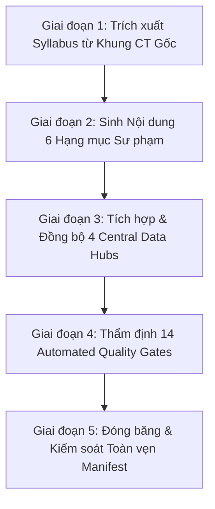

# 🏭 ENGQUEST3K — WEEK PRODUCTION SOP (STANDARD OPERATING PROCEDURE)

**Document Reference**: `docs/WEEK_PRODUCTION_SOP.md`  
**Version**: 2.2.0 (Unified 15 Quests / 5 Zones + Lite Mode W01–W16, Multi-Level Assessment & 28-Mock Test Cadence)  
**Governing Standard**: Cambridge CEFR (Pre-A1 to B1+) & W33 Golden Standard Architecture  
**Effective Date**: 2026-09-05  
**Status**: 🟢 **CANONICAL PRODUCTION SOP**

---

## 1. Core Production Philosophy & Master Invariants

Every week created for EngQuest3K (from Week 01 to Week 156) must adhere strictly to these fundamental principles:

1. **Master 15-Quest / 5-Zone Invariant (W17–W156)**:
   - Every week from W17 onward operates on **exactly 5 Days = 5 Zones = 15 Quests** (3 Quests per day).
   - Fragmented legacy "stations" (`explore.js`, `daily_watch.js`, `logic_lab.js`) are **strictly prohibited** as standalone data files.
   - **⚠️ LITE MODE (W01–W16)**: Pre-A1 Starters weeks operate on **10 Quests / 5 Zones (2 Quests/Day)** due to cognitive load constraints for 6–7 year olds. See MASTER_ARCHITECTURE §9 for details.
2. **Four Central Data Hubs Invariant**:
   - All week content lives exclusively in **4 Data Hubs**: `reading_hub.js`, `listening_hub.js`, `writing_hub.js`, `speaking_hub.js`.
3. **Zero-Cloning & Single-Source Invariant**:
   - Weeks are authored from the authoritative syllabus (`docs/1. NEW-FINAL_Khung CT_SYLLABUS_3yrs copy.txt` and `docs/ENGQUEST_DIGITAL_SYLLABUS_W01_W156_MAP.md`).
   - Copying raw content or hardcoded strings from older weeks without adapting them to the new week's theme is strictly prohibited.
4. **Hai Hình Thái Tuần Học (Two Production Modalities)**:
   - **Type A: Tuần Luyện Tập Xoay Vòng (Rotary Practice Week — 80% số tuần)**: Zone 5 trên Day 5 đánh giá quá trình tập trung sâu vào **4 Cambridge Parts xoay vòng**.
   - **Type B: Tuần Thi Thử Trọn Vẹn (Full Mock Test Week — 28 tuần trên toàn khóa)**: Cờ `isFullMock: true` trong `index.js`. Zone 5 kích hoạt toàn bộ bài thi chuẩn hóa có đếm ngược thời gian nghiêm ngặt.
5. **Standard Task Naming & CLIL Sư Phạm Invariant**:
   - **`science_lab` MUST be displayed as `Action Lab`** on all UI screens, reflecting interdisciplinary CLIL (science, social studies, geography, history, and experimental problem-solving). Never display as "Science Lab".
   - **`science_report` MUST be displayed as `Discovery Report`**.
   - **`sentence_smash` MUST be displayed as `Grammar Duel`**.
   - **`math_quest` MUST be displayed as `Math Quest`**.
   - **`broadcast_studio` MUST be displayed as `Video Challenge`**.
6. **No-Fallback & Fail-Loud Invariant**:
   - Interactive components must never use silent dummy text fallbacks. If required data is missing from the hub, render an explicit warning banner and fail loudly during audit.
7. **Authentic Cambridge 2-Play Loop Invariant**:
   - Listening Part 1–5 audios must follow the authentic Cambridge cycle:
     $$\text{Play 1} \longrightarrow \text{"Now listen to Part X again."} \longrightarrow \text{3-second pause} \longrightarrow \text{Play 2} \longrightarrow \text{"That is the end of Part X."}$$
8. **Speaking Part 3 (Picture Story) Standard**:
   - Supports 4 or 5 images. Examiner introduces Picture 1; student narrates subsequent pictures (Pictures 2–4 or Pictures 2–5).
9. **Action Lab 3-Scenario Depth Standard**:
   - The Action Lab must feature 3 distinct interactive scenarios/diagrams (`stages: [Stage 1, Stage 2, Stage 3]`) covering physical causes, materials comparison, and safety/first aid procedures. Never ship a single-image trivial lab.
10. **Canonical Audio Fallback Hierarchy Invariant**:
    - Pre-generated Static MP3 (in `public/audio/week{N}/` & Cloudflare R2 CDN) $\rightarrow$ Client IndexedDB Cache (`TTSCache.get`) $\rightarrow$ Google Cloud TTS Direct (only when uncached or live dynamic) $\rightarrow$ Browser TTS fallback (only on fatal error). All components must supply valid `audioUrl` parameters.
11. **Dual-Store Universal Progress Persistence & Return-to-Map Navigation Invariant (2026-09-05)**:
    - All 15 Quests must save completion to both `useDailyQuestStore` (`completedQuests['w' + weekId][questId]`) and `useUserStore` (`progressCache[weekId][stationId]` + Supabase cloud backup).
    - `useDailyQuestStore.completeQuest` is the single canonical entry point with automatic alias mapping (`science_lab` $\leftrightarrow$ `action_lab`, `story_writer` $\leftrightarrow$ `story_writing`, `broadcast_studio` $\leftrightarrow$ `video_challenge`, `gear4_clil` $\leftrightarrow$ `clil`).
    - Every Quest component must accept `onBackToMap` / `onComplete` and provide a clean, celebratory return path to the Quest Map (`/week/{weekId}/hub/1`) without getting trapped.
12. **Everyday Conversation & Cambridge Exam Dictation Invariant (2026-09-05)** [DEPRECATED / ABOLISHED — Khai tử theo Quyết định Kiến trúc 15 Quests Gói 003B, commit c30ab03e + efe32bb3]:
    - This dialogue must NEVER copy or duplicate Shadowing sentences or CLIL scientific texts.
    - Consisted of 8 short turns forming an authentic everyday conversation dialogue between characters/friends related to the week's theme.
    - Mandatory inclusion of Cambridge Movers/Flyers tested entities: numbers (times, rooms, phone digits, durations), days of the week, dates, names, places, and everyday conversational collocations/chunks.


---

## 2. Universal Weekly Structure: 15 Quests / 5 Zones

```
WEEKLY STRUCTURE (15 TASKS / 5 DAYS):
├── DAY 1: Zone 1 — Story World
│    ├── Quest 1: gear1_webtoon      ──> Scene Explorer (Comic immersion)
│    ├── Quest 2: gear2_karaoke      ──> Voice Shadow (Acoustic karaoke sync)
│    └── Quest 3: gear3_retell       ──> Story Retell (ESL Collocation Chunks)
├── DAY 2: Zone 2 — Knowledge Lab
│    ├── Quest 1: gear4_clil         ──> Fact Finder (Non-fiction reading & audio glossary)
│    ├── Quest 2: science_lab        ──> Action Lab (Interdisciplinary experiment / problem)
│    └── Quest 3: science_report     ──> Discovery Report (Observation Data Card + 1-Tap Pills)
├── DAY 3: Zone 3 — Battle Arena
│    ├── Quest 1: word_blitz         ──> Speed Match (Fast vocabulary pairing)
│    ├── Quest 2: sentence_smash     ──> Grammar Duel (Sentence syntax battle vs AI bot)
│    └── Quest 3: math_quest         ──> Math Quest (Singapore Math Bar Models & C.U.B.E.S.)
├── DAY 4: Zone 4 — Creator Studio
│    ├── Quest 1: story_writer       ──> Story Writer (3-panel narrative writing >= 20 words)
│    ├── Quest 2: broadcast_studio   ──> Video Challenge (Webcam presentation & recording)
│    └── Quest 3: info_exchange      ──> Info Exchange (2-way Q&A cue cards with info gaps)
└── DAY 5: Zone 5 — Boss Castle (Summative Assessment)
     ├── Quest 1: boss_listening     ──> Listening Shield (Cambridge Parts 1–5 rotary / Mock)
     ├── Quest 2: boss_reading       ──> Reading & Writing Shield (Parts 1–6 rotary / Mock)
     └── Quest 3: weekly_review      ──> Speaking & Passport (Speaking Parts 1–4 / Debate)
```

---

## 3. Ba Thế Hệ Khảo Thí Zone 5 (Day 5: Boss Castle)

Tùy thuộc vào tuần đang sản xuất thuộc giai đoạn nào, Zone 5 sẽ nạp dữ liệu theo đúng chuẩn khảo thí của thế hệ đó:

1. **Thế hệ 1 (Weeks 01–72): Cambridge Young Learners (Starters $\rightarrow$ Movers $\rightarrow$ Flyers)**:
   - `boss_listening`: Listening Parts 1–5 (vẽ đường nối, ghi chép notepad, nối thẻ A-H, trắc nghiệm 3 tranh, tô màu và viết).
   - `boss_reading`: Reading Parts 1–6 + Part 7 Writing truyện 3 tranh $\ge 20$ từ.
   - `weekly_review`: Speaking Parts 1–4 (tìm điểm khác, info exchange, kể tiếp truyện tranh, phỏng vấn). Thang điểm **15 Khiên Cambridge**.
2. **Thế hệ 2 (Weeks 73–112): Cambridge B1 Preliminary (PET) & CLIL STEM Lab**:
   - `boss_listening`: PET Listening Parts 1–4 (7 hội thoại ngắn, note completion thông báo, phỏng vấn độc thoại dài, hội thoại quan điểm).
   - `boss_reading`: PET Reading Parts 1–6 (biển báo, matching người-văn bản, gapped text điền câu, open cloze) + Writing viết email/bài báo $\ge 100$ từ.
   - `weekly_review`: PET Speaking Parts 1–4 + Vấn đáp thực nghiệm khoa học **CLIL CER Viva Voce**. Thang điểm **Cambridge English Scale 140–160**.
3. **Thế hệ 3 (Weeks 113–156): B1+ Strong Academic Reading & Structured Opinion**:
   - `boss_listening`: B1+ Academic Listening 4 Parts (nghe bài giảng khoa học, note-taking podcast học thuật, hội thoại chuyên đề dài).
   - `boss_reading`: B1+ Academic Reading 6 Parts (đọc bài văn 500–800 từ, trích xuất luận điểm, inference questions, gapped text) + Writing Opinion Essay $\ge 140–190$ từ và Extended Project Report $\ge 500$ từ.
   - `weekly_review`: Thuyết trình quan điểm có chuẩn bị (Structured Opinion Presentation 3–5 phút) + Ghi hình Extended Project Report + Phỏng vấn học thuật. Thang điểm **B1+ Academic Proficiency Scale + Portfolio Grade (A/B/C/D)**.

---

## 4. Chu Kỳ 28 Tuần Full Mock Test

Khi biên soạn tuần có mã `★ FULL MOCK`, tác giả bắt buộc phải khai báo:
```javascript
// src/data/weeks/week_XX/index.js
export default {
  weekNumber: XX,
  isFullMock: true,
  mockExamType: "FLYERS" // hoặc "STARTERS", "MOVERS", "B1_PET", "B2_FCE_ACELLUS"
  // ...
};
```

### Danh mục 28 Tuần Mock Test:
- **Starters (1 Mock)**: W16
- **Movers (2 Mocks)**: W24, W32
- **Flyers (8 Mocks - Nhịp 4+1)**: W37, W42, W47, W52, W57, W62, W67, W72 (Official Flyers Gate)
- **B1 PET & CLIL (8 Mocks - Nhịp 4+1)**: W77, W82, W87, W92, W97, W102, W107, W112 (Official PET Gate)
- **B2 FCE & Acellus (9 Mocks - Nhịp 4+1)**: W117, W122, W127, W132, W137, W142, W147, W152, W156 (Final Capstone & Graduation)

> **Note**: Giai đoạn W113–W156 mục tiêu điều chỉnh thành **B1+ Academic Reading & Structured Opinion** (thay vì B2 FCE/Acellus). Mock Test labels trên UI hiển thị là `★ B1+ Academic Assessment Mock`.

---

## 5. Productive Tasks Scaffolding Standard

All creative and productive tasks must provide a **3-Level Scaffolding Engine** so learners never face a blank canvas:

1. **Level 1 (Full Scaffolding)**:
   - **`story_retell`**: 100% full model sentence with tap-to-listen audio.
   - **`discovery_report`**: 1-Tap Word Pills with fill-in-the-blanks.
   - **`story_writer`**: Guided Cloze frame with word options for each of the 3 pictures.
   - **`broadcast_studio`**: Auto-scrolling teleprompter with karaoke timing.
   - **`info_exchange`**: Full question given with model audio pronunciation.
2. **Level 2 (Moderate Scaffolding / Chunks)**:
   - **`story_retell`**: Linear Thinking ESL Collocation chunks in brackets (`Jake was [walking carefully] down the [school corridor].`). Cheating-proof, never alternating single-word blanks.
   - **`discovery_report`**: Sentence starters linking to the Data Card (`The data proves that... because...`).
   - **`story_writer`**: Collocation keyword pills (4–5 phrase chunks per picture).
   - **`broadcast_studio`**: Chunk-segmented teleprompter with breath pause markers (`//`).
   - **`info_exchange`**: Question scaffolding stems (`Where / science room?` $\rightarrow$ learner forms question).
3. **Level 3 (Autonomous / Open)**:
   - **`story_retell`**: Key character and verb prompt outline.
   - **`discovery_report`**: Full CER Canvas (Claim, Evidence, Reasoning) with transition word bank.
   - **`story_writer`**: Open 3-picture composition with word counter gauge and Rubric checklist.
   - **`broadcast_studio`**: Bulleted talking point cue cards and presentation timer.
   - **`info_exchange`**: Raw cue cards with only field names given; student forms questions independently.

---

## 6. The Dictation 3-Step Engine [DEPRECATED / ABOLISHED — Khai tử theo Quyết định Kiến trúc 15 Quests Gói 003B, commit c30ab03e + efe32bb3]

Whenever such note-taking exercises occur (Cambridge Listening Part 2 notepad note-taking, spelling, and everyday dialogue):
1. **Step 1: Authentic Two-Play Listening**:
   - Audio plays twice with a 3-second thinking pause.
   - Student types notes into digital notepad without visual prompts.
2. **Step 2: Visual Diff Verification**:
   - System displays a character-level color-coded visual diff (Green for correct, Red for missing or typo).
3. **Step 3: Listen & Shadow Loop**:
   - Plays target native audio model.
   - Student records voice repeating the sentence with real-time feedback on pronunciation and rhythm.

---

## 7. Quy Trình Sản Xuất Tuần Chuẩn Hóa 5 Giai Đoạn (Mass Production Pipeline W01–W156)

Quy trình sản xuất công nghiệp chuẩn hóa để nhân bản tuần học (chuẩn bị mass production cho ~136 tuần W01–W32 và W35–W156) mà không cần suy luận thủ công lại từ đầu:



---

### Giai đoạn 1: Trích xuất Thông số từ Khung CT Gốc 156 Tuần (Authoritative Syllabus Ingestion)

- **Mục tiêu**: Lấy đúng chủ đề, thể loại bài đọc, kỹ năng và ngữ pháp mục tiêu từ nguồn dữ liệu gốc duy nhất được đóng băng.
- **Tài liệu nguồn (Inputs)**:
  1. `docs/1. NEW-FINAL_Khung CT_SYLLABUS_3yrs copy.txt` (Khung CT gốc 156 tuần chính thức).
  2. `docs/ENGQUEST_DIGITAL_SYLLABUS_W01_W156_MAP.md` (Bản đồ số hóa chi tiết 156 tuần).
- **Các thông số bắt buộc trích xuất**:
  - `weekNumber`: Số thứ tự tuần ($1 \dots 156$).
  - `theme`: Chủ đề tuần học (e.g. W34: *"The Lion and the Mouse & Forest Ecosystem"*).
  - `cefr_stage`: Giai đoạn CEFR (Stage 1: Pre-A1 $\rightarrow$ A2 Flyers; Stage 2: A2+ $\rightarrow$ B1 PET; Stage 3: B1+ Academic).
  - `week_type`: Type A (Rotary Practice Week) hoặc Type B (Full Mock Test Week với `isFullMock: true`).
  - `grammar_focus`: Trọng tâm ngữ pháp (e.g. Past Continuous with *While/When*).
  - `clil_topic`: Chủ đề khoa học/xã hội liên môn tích hợp.
  - `phonics_focus` / `vocab_domain`: Miền từ vựng và ngữ âm.
- **Đầu ra (Output)**:
  - File thông số tuần `src/data/weeks/week_{N}/blueprint.json` chứa toàn bộ metadata sư phạm.

---

### Giai đoạn 2: Sinh Nội Dung 6 Hạng Mục Sư Phạm Bắt Buộc (6 Core Pedagogical Deliverables)

### Giai đoạn 2: Sinh Nội Dung 6 Hạng Mục Sư Phạm Bắt Buộc (6 Core Pedagogical Deliverables — W34 Gold Standard Checklist)

Lấy Tuần 34 làm khuôn mẫu chuẩn mực (Gold Standard Template), tác giả và agent bắt buộc phải rà soát qua bảng **Checklist Sư phạm 6 Hạng mục** trước khi ráp vào hệ thống:

#### 📋 Checklist Chi tiết 6 Hạng mục Sư phạm:

- [ ] **1. Hạng mục 1: Bài đọc Khoa học Liên môn CLIL (Interdisciplinary CLIL Article)**:
  - Dung lượng: 90 – 200 từ (chuẩn A2 Flyers: ~120 – 150 từ).
  - Độ dài câu: $\le 28$ từ/câu; chứa tối thiểu 3 fact units hoàn chỉnh (Subject + Action + Outcome).
  - **Nguyên tắc Toàn vẹn Thuật ngữ (100% Glossary In-Text Presence)**: 100% các thuật ngữ trong `glossary` ($\ge 7$ từ) BẮT BUỘC phải xuất hiện thực tế trong văn bản `content_en`, CẤM định nghĩa từ mà bài đọc không dùng.
  - Đi kèm: 5 câu hỏi đọc hiểu `check_questions` và 1 câu hỏi tư duy phản biện `critical_thinking`.

- [ ] **2. Hạng mục 2: Danh mục Từ vựng Mục tiêu Cốt lõi & Ôn tập (Vocab & Foundation Review)**:
  - Đúng 20 từ vựng cốt lõi mới (`week{N}Vocab`) theo chuẩn CEFR của tuần.
  - Mỗi từ có đầy đủ: `word`, `definition_en`, `definition_vi`, `example_en`, `example_vi`, `audio_word`.
  - **Mở rộng Ôn tập Ngắt quãng (SRS Foundation Review)**: Bổ sung các từ mục tiêu nền tảng xuất hiện trong tuần (e.g. `tiny`, `huge`, `help`) có gắn cờ `tier: "foundation_review"` để hệ thống SRS nạp vào lịch ôn tập ngắt quãng.
  - **Ghi chú Từ vựng CLIL Mở rộng**: Ghi rõ `category: "CLIL_EXTENSION"` cho các thuật ngữ khoa học vượt chuẩn Flyers một bậc (e.g. `ecosystem`) để hệ thống kiểm tra tự động (`gate12`) không cảnh báo lỗi vượt cấp độ.

- [ ] **3. Hạng mục 3: Voice Shadowing & Trọng tâm Ngữ âm (Pronunciation & Phonology Triad)**:
  - Gồm 8 câu luyện phát âm bám sát cốt truyện.
  - Đầy đủ phiên âm IPA cho từng từ (`ipa: [...]`).
  - **Bộ Ba Âm Đuôi Quá Khứ (Past Tense -ed Ending Triad)**: Nếu tuần có trọng tâm phát âm quá khứ đơn, 8 câu Shadowing BẮT BUỘC phải bao quát đầy đủ cả 3 nhóm âm đuôi:
    - Nhóm **/t/** (sau âm vô thanh /p, k, f, s, ʃ, tʃ/: `trapped`, `promised`, `escaped`, `thanked`).
    - Nhóm **/d/** (sau âm hữu thanh và nguyên âm: `chewed`, `roared`, `freed`, `stayed`).
    - Nhóm **/ɪd/** (sau âm /t/ và /d/: `rested`, `trusted`, `waited`, `started`).

- [ ] **4. Hạng mục 4: Các đoạn văn khảo thí F5D3 Reading & Writing Passages**:
  - `rw_part1`: 15 từ vựng Word Bank + 10 định nghĩa + 1 ví dụ mẫu.
  - `rw_part2`: Cuộc trò chuyện Dialogue A-H gồm 5 lượt thoại (`turns`) + 8 phương án (`answer_options`) + 1 ví dụ mẫu (`example`).
  - `reading_part3_story`: Bài đọc điền từ 5 chỗ trống + 10 từ Word Bank + 3 phương án chọn tiêu đề (`title_options`).
  - `rw_part4`: Bài đọc ngữ pháp Cloze 10 chỗ trống trắc nghiệm 3 lựa chọn (`blanks`) + 1 ví dụ mẫu blank 0.
  - `rw_part5`: Đoạn văn trích xuất thông tin 7 câu điền từ tự do (`questions`, không có phương án trắc nghiệm) + 1 ví dụ mẫu.
  - `rw_part_6`: Bài viết nhật ký Open Cloze 5 chỗ trống điền 1 từ duy nhất + 1 ví dụ mẫu.

- [ ] **5. Hạng mục 5: Dữ liệu Tương tác Mini-games F7D1 & Action Lab**:
  - `science_lab` (Action Lab): Cung cấp tối thiểu 3 kịch bản / diagram tương tác (`stages: [Stage 1, Stage 2, Stage 3]`) về nguyên nhân vật lý, vật liệu đối ứng và quy trình xử lý thực tế theo Invariant 7.
  - `singapore_math`: Đúng 5 bài toán tư duy Bar Model theo chuẩn C.U.B.E.S. kèm dữ liệu `modelData` (part-whole / comparison) khớp 100% kết quả tính toán.
  - `grammar_drills`: 5 câu Grammar Duel sắp xếp trật tự từ có từ gây nhiễu (`distractor_blocks`).
  - `story_writer`: Khung 3 bức tranh với 3 nấc thang MODEL $\rightarrow$ BUILD $\rightarrow$ WRITE và từ nối thời gian (`connectors`).

- [ ] **6. Hạng mục 6: Kịch bản Âm thanh & Asset Âm thanh Pre-generated**:
  - Khai báo đầy đủ và tạo sẵn file MP3 vật lý trong `public/audio/week{N}/`:
    - 8 câu Voice Shadowing.
    - Bài đọc CLIL Explore.
    - 20+ file âm thanh từ vựng (`vocab_{word}.mp3`).
    - Listening Parts 1–5 và Speaking Part 2/4.
  - Đảm bảo 100% file tồn tại và dung lượng $> 0\text{ bytes}$ để vượt qua Gate 3.

- **Đầu ra (Output)**: Bộ bản thảo nội dung sẵn sàng ráp vào các Hub.

---

### Giai đoạn 3: Tích Hợp & Đồng Bộ 4 Central Data Hubs (Hub Integration & Purity)

- **Mục tiêu**: Tạo lập cấu trúc thư mục `src/data/weeks/week_{N}/` và xuất khẩu đúng chuẩn các biến dữ liệu:
  - `index.js`: Khai báo metadata tuần (`weekNumber`, `theme`, `cefr_level`, `isFullMock`, các hub con).
  - `reading_hub.js`: Webtoon story scenes (5 cảnh có hotspots), Voice Shadowing (8 câu có IPA), CLIL article & glossary, Cambridge Reading Parts 1–6.
  - `listening_hub.js`: Listening Parts 1–5 chuẩn Cambridge Movers/Flyers, Action Lab, Singapore Math, Grammar Duel.
  - `writing_hub.js`: Creative Story Writer (3 panels có 3 nấc thang), Discovery Report config (Data Card + 1-Tap Pills), Writing Chunks (4 nhóm ngữ đoạn).
  - `speaking_hub.js`: Video Challenge teleprompter, Info Exchange cue cards, Spot-Differences (4 cặp điểm khác biệt có tọa độ hotspot), Personal Questions.
  - `skill_practice_hub.js`: Tập trung Grammar Drills, Singapore Math 5 bài toán và Action Lab.

---

### Giai đoạn 4: Thẩm Định Độc Lập Qua 14 Automated Quality Gates (Automated Gate Sweep)

Tuần học BẮT BUỘC phải chạy tuần tự và đạt 100% PASS trên tất cả **14 Quality Gates**:

```bash
# 1. Gate 3: Kiểm tra toàn vẹn tài nguyên media vật lý (ảnh, audio)
node scripts/gate3_media_integrity.mjs {N}

# 2. Gate 4: Kiểm tra in đậm ngữ đoạn và cấu trúc cụm từ retell/shadowing
node scripts/gate4_chunk_bolding.mjs {N}

# 3. Gate 8: Quét sạch mã dự phòng và dummy string (No-fallback sweep)
node scripts/gate8_no_fallback_sweep.mjs {N}

# 4. Gate 10: Kiểm tra tính chuẩn xác ngữ pháp các câu ví dụ Cambridge
node scripts/gate10_example_grammaticality.mjs {N}

# 5. Gate 11: Kiểm tra độ phong phú nội dung (vocab, math, grammar drills, science_lab stages)
node scripts/gate11_content_richness.mjs {N}

# 6. Gate 12: Thẩm định cấp độ CEFR và độ dài câu từ vựng
node scripts/gate12_comprehensive_cefr.mjs {N}

# 7. Gate 13: Xác thực cấu trúc 5 Zones / 15 Quests và nhịp xoay vòng rotary
node scripts/gate13_rotary_schedule.mjs {N}

# 8. Gate 15: Kiểm thử DOM thực tế trên Headless Chrome & WebKit
node scripts/gate15_production_dom_assertions.mjs {N}

# 9. Gate 16: Thẩm định chất lượng CLIL fact units, banned strings & writing chunks
node scripts/gate16_content_quality.mjs {N}

# 10. Gate 17: Thẩm định Cambridge Mechanic Fidelity Doctrine (14 Invariants)
node scripts/gate17_fidelity_doctrine.mjs {N}

# 11. Gate 15 v2: Thẩm định tương tác chức năng động & phát âm thanh trên production
node scripts/gate15_v2_functional_audio_playtest.mjs {N}

# 12. Schema Uniformity Gate: Quét sạch fallback kép (.items || .fields) và lệch khóa
node scripts/gate_schema_uniformity.mjs {N}

# 13. Whitelist Entity Gate: Chặn đứng thực thể ngoại lai và rò rỉ nhân vật lạc đề
node scripts/gate_whitelist_entities.mjs {N}

# 14. Freeze Guard: Kiểm tra khóa toàn vẹn file và chống drift
node scripts/guard_golden_w{N}_freeze.mjs
```

**Bảng Tiêu chí Chấp thuận (Pass Criteria Matrix)**:

| Cổng (Gate) | Tên Gate Script | Tiêu chuẩn Đạt (Acceptance Criteria) |
|:---|:---|:---|
| **Gate 3** | `gate3_media_integrity.mjs` | 100% file ảnh và audio được khai báo tồn tại thực tế trên đĩa, không 404. |
| **Gate 4** | `gate4_chunk_bolding.mjs` | 100% câu narration có in đậm cụm từ Collocations hợp lệ. |
| **Gate 8** | `gate8_no_fallback_sweep.mjs` | 0 dummy strings (không chứa `"Related to "`, `"Lorem"`, `"placeholder"`). |
| **Gate 10** | `gate10_example_grammaticality.mjs` | 0 lỗi ngữ pháp trong các câu mẫu Cambridge Part 1–6. |
| **Gate 11** | `gate11_content_richness.mjs` | Đủ 20 từ vựng cốt lõi; 5 bài toán Singapore Math, 5 câu Grammar Drills và Action Lab 3 stages. |
| **Gate 12** | `gate12_comprehensive_cefr.mjs` | 0 vi phạm từ vựng ngoài CEFR A2 Flyers (cho Stage 1); độ dài câu đạt chuẩn. |
| **Gate 13** | `gate13_rotary_schedule.mjs` | Đúng 5 Zones / 15 Quests; phân bổ 3 Quests/ngày khớp 100% Ma trận. |
| **Gate 15** | `gate15_production_dom_assertions.mjs` | 15/15 Quests render thành công trên DOM production, 0 console error. |
| **Gate 16** | `gate16_content_quality.mjs` | $\ge 3$ fact units CLIL; 0 banned strings; 4 nhóm writing chunks hoàn chỉnh. |
| **Gate 17** | `gate17_fidelity_doctrine.mjs` | `schemaValid: true`; 14/14 Invariants PASS; 16/16 component Cambridge tồn tại. |
| **Gate 15 v2** | `gate15_v2_functional_audio_playtest.mjs` | 15/15 quest functional PASS: 0 runtime TTS, 0 missing audio, 0 frozen phases, 0 dictation tabs |
| **Schema Uniformity** | `gate_schema_uniformity.mjs` | 0 dual-fallback patterns, 0 schema key drift |
| **Whitelist Entity** | `gate_whitelist_entities.mjs` | 0 rogue entity violations |
| **Gate Guard** | `guard_golden_w{N}_freeze.mjs` | 100% file cốt lõi khớp mã băm SHA-256 đã đóng băng trong Manifest. |

---

### Giai đoạn 5: Đóng Băng Chất Lượng & Tạo Manifest Hash (Freeze & Verification)

- **Mục tiêu**: Khóa chặt nội dung tuần học sau khi vượt qua toàn bộ 14 Gates, đảm bảo không bị drift hoặc vô tình sửa đổi trong các đợt refactor hệ thống sau này.
- **Các bước thực hiện**:
  1. Tính mã băm SHA-256 cho các file dữ liệu cốt lõi (`reading_hub.js`, `listening_hub.js`, `writing_hub.js`, `speaking_hub.js`, `skill_practice_hub.js`, `vocab.js`, `GATE15_SPEC_W{N}.json`).
  2. Ghi nhận vào file manifest đóng băng: `docs/W{N}_GOLDEN_FREEZE_MANIFEST.json`.
  3. Thiết lập script bảo vệ `scripts/guard_golden_w{N}_freeze.mjs` và thêm vào suite CI/CD.
  4. Thực hiện Git commit với thông điệp chuẩn hóa:  
     `feat(week-{N}): freeze golden standard curriculum core [14-gates-passed]`

---

## 9. Multi-Agent Review Protocol & Verification Checklist

Before pushing to production, the authoring agent must execute the **Multi-Agent Review Checklist**:

- [ ] **Variable Declarations**: No undeclared variables or TDZ risks.
- [ ] **Cheat-proofing**: Speech recognition requires authentic voice input; no bypass length mocks.
- [ ] **Data Integrity**: `logAttempt` called only when `isAttempted: true`.
- [ ] **Build Verification**: `npm run build` exits with code 0.
- [ ] **Manifest Drift Test**: `npm run test:manifest:drift` passes.
- [ ] **5-Feature Compliance**: `node scripts/gate18_feature_compliance.mjs N` exits with code 0 (or ⚠️ warnings-only for W33–W48).
- [ ] **Reviewer Report**: Documented in commit message or PR summary.

---

## 10. 5-Feature Data Contracts (v2.0.0 — 2026-09-05)

The following features require specific data contracts in week hub files. Content-writer subagents and human authors MUST include these contracts when producing new weeks.

### 10.1 Feature-to-Data Mapping

| Feature | Data Location | Required Fields | First Week Required |
|---|---|---|---|
| **SRS Leitner 5-Box** | `reading_hub.js → vocab[]` | `word`, `definition_en`, `definition_vi` | W17 (auto-enroll) |
| **Inference Questions** | `reading_hub.js → clil_article.inference_questions[]` | `id`, `text`, `type`, + type-specific fields | W38 (optional), **W49+ enforced** |
| **Quick Write Panel** | None (dynamic prompts from context) | — | — |
| **Placement Test** | `data/placementTest.js` (one-time) | — | — |
| **Parent Dashboard Radar** | Computed from quest completion data | — | — |

### 10.2 Inference Questions Contract

Each `clil_article` in `reading_hub.js` MUST include an `inference_questions` array:

```javascript
inference_questions: [
  {
    id: 'infer_1',                           // Must start with "infer_"
    text: 'Why did Jake help the new student?', // "Why?" or "What can we learn?" format
    type: 'mcq_with_evidence',               // or 'open_response'
    options: ['Because...', 'Since...', 'Due to...'], // 3–4 options (MCQ only)
    correct: 0,                              // index of correct answer (MCQ only)
    scaffoldHint: 'Look at paragraph 2...',  // optional scaffold for Learn mode
  },
  {
    id: 'infer_2',
    text: 'What can we learn from this experiment?',
    type: 'open_response',
    modelAnswer: 'We can learn that...',     // required for open_response
    acceptableKeywords: ['friction', 'force', 'surface'], // required for scoring
  },
]
```

**Minimum counts by generation:**
- Gen 1 (W33–W72, A2 Flyers): ≥2 items
- Gen 2 (W73–W112, B1 PET): ≥2 items
- Gen 3 (W113–W156, B1+ Academic): ≥3 items (deeper analytical types)

### 10.3 Vocab SRS Contract

The `vocab` array in `reading_hub.js` MUST have **exactly 20 items**, each with:
- `word` (string) — the target vocabulary word
- `definition_en` (string) — English definition
- `definition_vi` (string) — Vietnamese definition with full diacritics

These fields are consumed by the SRS Leitner 5-Box system for automatic flashcard enrollment.

### 10.4 Golden Templates

Reference templates for content-writer subagents:

| Template | Range | Path |
|---|---|---|
| Flyers Rotary (80% of weeks) | W33–W72 | `production_kit/templates/template_flyers_rotary.js` |
| Flyers Full Mock (20%) | W37, W42, ... W72 | `production_kit/templates/template_flyers_mock.js` |
| PET Transition | W73–W112 | `production_kit/templates/template_pet_transition.js` |
| B1+ Academic Transition | W113–W156 | `production_kit/templates/template_b1plus_transition.js` |

### 10.5 Automated Gate Validation

```bash
# Run after content creation, before commit
node scripts/gate18_feature_compliance.mjs <weekNumber>
```

**Enforcement timeline:**
- **W33–W48**: Warnings only (transition period, gate exits 0)
- **W49+**: Strict enforcement (gate exits 1 on missing data)

---

## 11. Universal Progress Persistence & Return-to-Map Navigation Standards (W01–W156)

### 11.1 The Dual-Store Architecture
EngQuest3K uses two synchronized state stores for user progress:
1. **`useDailyQuestStore` (`src/stores/useDailyQuestStore.js`)**:
   - Manages Day 1–5 unlock progression, 15 Quests completion matrix (`completedQuests['w' + weekId][questId]`), and XP/streak gamification.
   - Authoritative dispatcher: `completeQuest(weekId, questId, options)`.
   - Built-in `QUEST_ALIAS_MAP` automatically harmonizes technical station IDs and quest names:
     - `science_lab` $\leftrightarrow$ `action_lab`
     - `story_writer` $\leftrightarrow$ `story_writing`
     - `broadcast_studio` $\leftrightarrow$ `video_challenge`
     - `gear4_clil` $\leftrightarrow$ `clil`
     - `science_report` $\leftrightarrow$ `discovery_report`
     - `word_blitz` $\leftrightarrow$ `speed_match`
     - `sentence_smash` $\leftrightarrow$ `grammar_duel`
     - `math_quest` $\leftrightarrow$ `bar_model`
2. **`useUserStore` (`src/stores/useUserStore.js`)**:
   - Manages user profile, local progress cache (`progressCache[weekId][stationId]`), and Supabase cloud persistence (`syncProgressToServer`).
   - Auto-updated by `useDailyQuestStore.completeQuest` on every quest completion.
3. **`useStationProgress` Hook (`src/hooks/useStationProgress.js`)**:
   - Provides station-level state (`saveProgress`, `isCompleted`, `score`).
   - Automatically synchronizes with `useDailyQuestStore.completeQuest` whenever `saveProgress(partialData, true, score)` is invoked.

### 11.2 15-Quest Completion & Navigation Checklist
Every component representing one of the 15 Quests MUST implement the following UX pattern:
1. **Prop Acceptance**: Accept `onBackToMap` and `onComplete` passed down from `TaskScreen.jsx` and Zone containers.
2. **Completion Recognition**: Read both stores on mount (`useDailyQuestStore.isQuestCompleted` or `useStationProgress.isCompleted`). If already completed:
   - Display a prominent `✓ Completed` badge in the header or hero card.
   - Allow the student to replay/review freely without losing completion state.
3. **Finish Action**: Upon completing the quest activity:
   - Call `useDailyQuestStore.getState().completeQuest(weekId, questId, { score })` or `saveProgress(..., true, score)`.
   - Provide an explicit, prominent button: e.g. `✓ Return to Map (+50 XP)` or `✓ Finish Quest & Return to Map`.
   - Trigger `onBackToMap()` or `onComplete()` to navigate cleanly back to `/week/${weekId}/hub/1`. Never leave the student trapped on a static screen.

---

## 12. Chronicles 21 Mini-Game Mode Architecture & Release Gating Standards

### 12.1 The Master 21 Mini-Game Roster (7 Floors × 3 Doors)
Super Leo Chronicles organizes gamified dungeon crawling across 7 Floors (Days 1–7), with each floor presenting exactly 3 doors:

| Floor | Door 1: Vocab | Door 2: Grammar | Door 3: Integration | Component File |
|---|---|---|---|---|
| **F1** | `arcane_bubble` (Arcane Bubble) | `spell_train` (Spell Train) | `lexical_det` (Lexical Detective) | `ShadowVaultInfiltrate.jsx` / `SyntaxExpressRail.jsx` |
| **F2** | `crystal_match` (Crystal Match) | `rune_forge` (Rune Forge) | `ancient_scroll` (Ancient Scroll) | `CrystalMatch.jsx` / `AncientScrollLab.jsx` |
| **F3** | `phonics_bubble` (Phonics Bubble) | `chunk_catapult` (Chunk Catapult) | `meteor_smasher` (Meteor Smasher) | `ChunkCatapultCanvas.jsx` / `MeteorSmasher.jsx` |
| **F4** | `highway_runner` (Highway Runner) | `spell_train_express` (Syntax Express) | `lexical_riddle` (Lexical Riddle) | `HighwayRunnerGame.jsx` / `SyntaxExpressGame.jsx` |
| **F5** | `grand_matrix` (Grand Matrix) | `titan_forge` (Titan Forge) | `cambridge_cloze` (Cambridge Cloze) | `GrandMatrixGrid.jsx` / `CambridgeClozeLab.jsx` |
| **F6** | `synonym_storm` (Synonym Storm) | `connector_relay` (Connector Relay) | `story_sequencer` (Story Sequencer) | `SynonymStormGame.jsx` / `ConnectorRelayGame.jsx` / `StorySequencerGame.jsx` |
| **F7** | `word_forge_scramble` (Word Forge) | `question_quest` (Question Quest) | `rune_balance_scale` (Word Class Duel) | `WordForgeScrambleGame.jsx` / `QuestionQuestGame.jsx` / `WordClassDuelGame.jsx` |

- **Floor Navigation Invariant**:
  In `ChroniclesScreen.jsx`, the condition to intercept for Mystery Vault / Boss Chamber MUST be `activeDayIndex >= 7` (representing all 7 daily rooms). Setting `activeDayIndex >= 5` prematurely blocks access to Floors 5 and 6.

### 12.2 Required Weekly Chronicles Content Assets (W34+)
Every newly authored week must supply two dedicated files alongside the 4 Data Hubs:
1. **`src/data/weeks/week_{N}/wh_questions.js`**:
   - 5 pre-generated WH-questions based on the week's Story Scenes & CLIL Article.
   - Suffix verb detection MUST strictly check `-ed` (`length >= 4 && endsWith('ed')`). Never match bare `-d`.
   - Never generate double possessives (`Maria's's`).
   - Only query "What did ... remind ... about?" if the clause explicitly contains the verb `remind`.
   - Pre-generate questions at build-time; never rely on naive runtime heuristics.
   - Header comment: `// Pre-generated WH Questions — pending pedagogy review before release`.
2. **`src/data/weeks/week_{N}/word_class_duel.js`**:
   - 4 target dual-class words (e.g. `grip`, `slide`, `care`, `help`).
   - Round 1 should prioritize genuine dual-class words from CLIL reading.
   - For authored contextual sentences (Rounds 2–4), document provenance clearly in comments.
   - Header comment: `// Word Class Duel draft — pending pedagogy review before release`.

### 12.3 BUG-002 Prevention & Pure Lexical Isolation
- **No Dummy Fallbacks**: CẤM TUYỆT ĐỐI `"Related to " + word` fallback in `contentService.js`, `extractQuestVocab.js`, `DailyRoomScreen.jsx`, and `ShadowVaultInfiltrate.jsx`.
- **Lexical Isolation**: Integration mini-game vocab extractors must filter out any item containing `.sentence` or text with $> 3$ words to prevent grammar sentences from polluting vocabulary pools.

### 12.4 Transparent Data Sizing & Assessment Metrics
- Standard week vocab loader imports: 20 words from `reading_hub.vocab` + 10 definitions from `writing_hub.rw_part_1.definitions` = 30 total array slots.
- For template/skeleton weeks (W34, W35), these 30 items are mock template entries until content is authored.
- Agents must never report 30/30 as "30 verified custom definitions" for unauthored weeks.

### 12.5 Release Gating & Pedagogical Sign-off Protocol
- While game engine code and components are frozen and pass all automated tests, **the content in `wh_questions.js`, `word_class_duel.js`, and Connector Relay MUST undergo human pedagogical review before being enabled for real students**.
- Pre-release gate checklist:
  - [ ] Human review of dual-class sentences in `word_class_duel.js`.
  - [ ] Human review of WH questions and hints in `wh_questions.js`.
  - [ ] Human review of conjunction drills in `ConnectorRelayGame.jsx`.
  - [ ] Verification of pure definitions across Floors 1–7 (0 `"Related to "` instances).
  - [ ] `npx eslint src/modules/chronicles/games/*.jsx` exit 0, `npm run build` exit 0.


